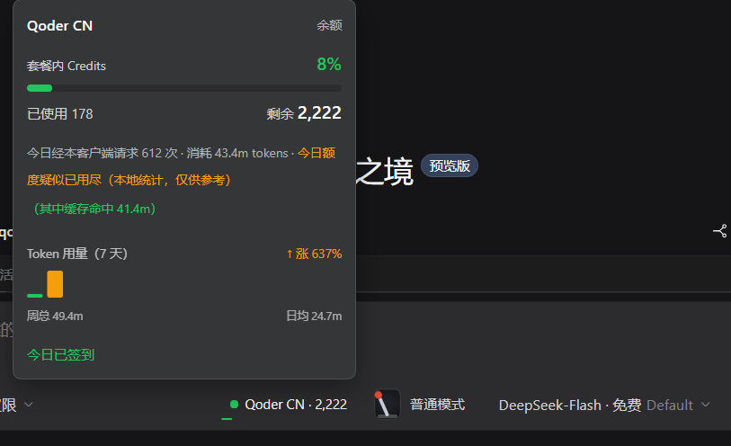

# DSH Connect Qoder

[](https://www.npmjs.com/package/@yeeeck/dsh-connect-qoder)


把本机已登录的 **Qoder** 接入 [DeepSeek Harness](https://github.com/deepseek-ai/deepseek-harness)，在 DSH 的模型选择器里直接使用 Qoder 账号的模型与额度。

国内版 **Qoder CN**（`qoder-cn`）与国际版 **Qoder**（`qoder`）是两个独立 provider：可以只装一个，也可以两个并存；账号、额度、模型目录与勾选互不影响。

> 本仓 fork 自 [eghrhegpe/dsh-connect-qoder](https://github.com/eghrhegpe/dsh-connect-qoder)，当前版本 **0.8.0**，npm 包名为 `@yeeeck/dsh-connect-qoder`。与 fork 源的差异见 [「相对于 fork 源的改动」](#相对于-fork-源的改动)。


## 功能

- **双区域、互不干扰**：国内版与国际版各自登录、各自计费；每个区域可以单独启用/停用模型。
- **模型目录自动同步**：从 Qoder 读取当前可用模型、上下文长度、视觉能力与错峰费率，不需要手写模型清单。
- **三种凭据来源**：Windows 上复用 Qoder 桌面端登录态；没有桌面端时用浏览器设备登录；最后可用环境变量 PAT 兜底。
- **用量与签到**：Plugins 页卡片和输入框旁的用量胶囊显示套餐额度、资源包、今日请求数、token 消耗、7 天趋势与每日签到。
- **失败可见**：日限额、排队、登录过期、协议格式变化、长回答卡死都有明确状态，不把失败伪装成空回答或“已更新”。
- **本地优先**：桌面端凭据只读，不写 Qoder 应用文件；loopback shim 使用随机端口与进程内 secret；签到是唯一会修改账号的手动操作。

## 安装

### 环境要求

- **DSH Host 0.2.x**（`>=0.2.0-rc.0 <0.3`）；0.1.x 宿主不再支持。
- **Node.js** `^22.19.0 || >=24.0.0`（源码构建或自建宿主时需要；只装 npm 包通常由 DSH 自带运行时满足）。
- 一个可用的 **Qoder 账号**。Windows 上可直接复用桌面端登录；macOS / Linux 用浏览器设备登录或 PAT。

### 从 npm 安装（推荐）

```sh
dsh plugin --profile web add @yeeeck/dsh-connect-qoder
```

桌面端把 `web` 换成 `desktop`：

```sh
dsh plugin --profile desktop add @yeeeck/dsh-connect-qoder
```

### 从 DSH 市场安装

在 DSH 的「插件市场」里粘贴：

```
github:YeEeck/dsh-connect-qoder
```

仓库已提交宿主产物 `lib/`（host + client bundle），`github:` 源克隆后即可加载，不需要批准构建脚本。如果 DSH 反而提示有待批准的构建脚本，说明它拿到了一份缺 `lib/` 的旧克隆；删掉重装即可。

### 从源码安装

```sh
git clone https://github.com/YeEeck/dsh-connect-qoder.git
cd dsh-connect-qoder
npm install
npm run build
dsh plugin --profile web add .
```

源码改动后需要重新 `npm run build`，否则运行的仍是 `lib/` 里的旧产物。

### 升级到 0.8.0

0.8.0 起包名迁移到 `@yeeeck/dsh-connect-qoder`，仓库与市场源也统一到 `YeEeck`。旧的 `@eghrhegpe/dsh-connect-qoder` 是 fork 源发布的包，fork 源可能继续维护；两个包不是同一个包，同时安装会互相掩盖。

升级前先卸载旧包（或在 profile 的 `package.json` 里删掉旧依赖），再安装新包：

```sh
dsh plugin --profile web add @yeeeck/dsh-connect-qoder
```

安装或升级后需要**重启 DSH 进程**：bundle 的 patch 在启动时读取。

## 使用

1. 打开 **Settings → Plugins → DSH Connect Qoder**。
2. 在版本条里选择 **Qoder CN** 或 **Qoder**，确认登录状态；需要时点「重读登录」或「浏览器登录」。
3. 勾选要启用的模型，按需设置最大上下文与逐模型图像模式，然后保存。
4. 在 DSH 模型选择器里选择对应模型开始对话；输入框工具栏的用量胶囊可直接查看余额、错峰窗口与今日签到。



## 凭据与安全

按优先级依次尝试三条来源：

1. **Qoder 桌面端登录态**：只读打开，不写入、不复制。桌面端 access token 过期后不再算数，插件会继续寻找下一条可用凭据。
2. **插件自己的设备登录**：在浏览器里批准一个码，令牌存到 `$DSH_HOME/.qoder-auth.<region>.json`（`0600`、按 region 分文件、临时文件改名原子写）。这是插件唯一自己持有并写下的凭据；面板上的「退出插件登录」删的就是它。
3. **环境变量 PAT**：`QODERCN_PAT`（国内版）或 `QODER_PAT`（国际版），只读，用于最后的兜底。

loopback shim 只绑定本机随机端口，并用进程内随机 bearer token 鉴权；Qoder 的真实 RSA 包装 key 与 session key 不离开插件沙箱。除手动「每日签到」外，插件对 Qoder 账号的请求都是只读的。

**平台边界**：桌面端凭据解密链目前只在 Windows 上实现（PowerShell + DPAPI）。macOS / Linux 上读不到桌面端登录，但可以直接使用浏览器设备登录或 PAT；设备登录本身是跨平台 API。完整说明见 [docs/credentials.md](docs/credentials.md)。

## 工作原理

```
DSH PiAiAdapter（每个区域一套）
  -> 安全 loopback shim（随机端口 + 进程内随机 secret）
  -> COSY 签名 + 自定义 base64 编码
  -> 国内版 https://gateway.qoder.com.cn/
  -> 国际版 https://api3.qoder.sh/
  -> Qoder 双层包装 SSE
  -> OpenAI SSE
  -> DSH 本地执行工具并回传结果
```

Qoder 不是 OpenAI 兼容端点，插件负责三件事：为每个网关请求生成 `Cosy-*` 签名头；把 `Encode=1` 的 JSON 体按置换字母表编码；把 Qoder 的双层 SSE 信封拆成 OpenAI 风格的 chunk。协议细节与模块职责见 [docs/architecture.md](docs/architecture.md)。

## 兼容性与已知限制

- **DSH Host 只支持 0.2 代**：插件声明 `>=0.2.0-rc.0 <0.3`，0.1.x 宿主会判为不兼容。
- **桌面端凭据读取仅 Windows**；macOS / Linux 走设备登录或 PAT。
- **Qoder 非官方开放 API**：Qoder 更新协议后，插件可能需要跟进；接口格式变化会作为独立错误提示「请更新插件」。
- **每日请求次数用尽 ≠ 排队**：用满后上游会把约两小时的等待伪装成排队；插件按日限额处理，提示日期切换后重置，并指出错峰价与签到两条路。
- **国际版试用额度**可能单独用尽，导致该区域不显示模型；国内版不受影响。
- **部分模型不允许关闭思考**（如 `GLM-5.3-Flash`、`Kimi-K3`），插件会省略 `enable_thinking: false`，让模型使用自己的默认档位。
- **没有自动更新**：DSH 暂不支持插件自动更新；升级时按上面的「先卸旧、再装新」操作。

更完整的行为与错误语义见 [docs/behavior.md](docs/behavior.md)，已知缺口见 [docs/KNOWN_GAPS.md](docs/KNOWN_GAPS.md)。

## 相对于 fork 源的改动

本仓 **fork 自 [eghrhegpe/dsh-connect-qoder](https://github.com/eghrhegpe/dsh-connect-qoder)**，本仓 fork 时的基线为 **v0.7.4**。下面只列本仓 **0.8.0** 相对该源的改动；0.7.4 及以前已有的双 region、三种凭据、用量、签到、模型目录等能力来自 fork 源，不重复列为“新增”。

| 主题 | 本仓的改动 |
|---|---|
| **包名与仓库身份** | 包名迁到 `@yeeeck/dsh-connect-qoder`；`homepage` / `repository` / `bugs` / author 统一到 `YeEeck`；DSH 市场源改为 `github:YeEeck/dsh-connect-qoder`。升级需先卸载旧包。 |
| **长回答与流看门狗** | 原来给单次请求挂绝对 60 秒期限，健康的长回答也会被自己人掐断。现在改为衡量**沉默**的空闲窗口：只要还在持续产出可解析的帧就不打断；首帧前卡死自动重试，已开始输出后再卡死则不重发半截答案；心跳、空行、不可解析字节不再算进度，插件先于宿主判死。 |
| **排队耐心** | 新增卡片档位 **2 / 4 / 6 分钟**（默认 4 分钟）。空闲窗口与流空闲天花板由档位推导，保证「空闲窗口 < 排队耐心 < 流空闲天花板」；每单次请求读取一次，下一次请求生效；配置写成不存在的档位时卡片明确告警；排队失败文案写明已等多久、耐心多少、重发会重新计时。 |
| **发布与 CI** | 增加 npm OIDC trusted publishing；投稿漂移检查改为按声明自动过期，避免未上架时误报。 |

完整逐版本记录见 [CHANGELOG.md](CHANGELOG.md) 的 0.8.0 条目。

## 开发

```sh
npm install
npm run build      # 从 src/ 重建 lib/
npm test           # node --test "test/*.test.js"
npm run verify     # 类型、审计、构建、全量测试与产物核验
```

- **`lib/` 是受版本管理的构建产物**：改 `src/` 后执行 `npm run build`，并把 `lib/` 与源码放在同一次提交；不要手改产物，也不要把 `lib/` 加回 `.gitignore`。CI 有产物新鲜度门禁。
- 测试直接 import `src/**/*.ts`，不需要安装 peer 依赖；构建需要 devDependency `tsdown`。
- 协作纪律与红线见 [AGENTS.md](AGENTS.md)；模块、产物与持久化文件见 [docs/architecture.md](docs/architecture.md)；验证链与测试分层见 [docs/testing.md](docs/testing.md)；发版流程见 [RELEASING.md](RELEASING.md)。

## 文档

| 文档 | 内容 |
|---|---|
| [docs/howto/symptom-triage.md](docs/howto/symptom-triage.md) | 按界面原文排查常见现象 |
| [docs/behavior.md](docs/behavior.md) | 已知行为、错误语义与用户可见后果 |
| [docs/credentials.md](docs/credentials.md) | 三种凭据来源、平台边界与写入安全 |
| [docs/KNOWN_GAPS.md](docs/KNOWN_GAPS.md) | 已知缺口与未覆盖项 |
| [docs/architecture.md](docs/architecture.md) | 数据流、模块目录、构建产物与持久化文件 |
| [docs/testing.md](docs/testing.md) | verify 链、覆盖率、测试分层与门禁 |
| [CONTEXT.md](CONTEXT.md) | 领域词表（请求、排队、空闲窗口等） |
| [RELEASING.md](RELEASING.md) | 发版与上架的唯一权威流程 |
| [CHANGELOG.md](CHANGELOG.md) | 逐版本变更记录 |

## 免责声明

仅供个人学习研究使用，仅驱动使用者自己的 Qoder 账号在本机调用。使用者需遵守 Qoder 的服务条款，因使用本项目产生的后果由使用者自行承担。本项目与 Qoder、DeepSeek 均无关联。

插件除「每日签到」外的所有请求都是只读的；签到是它唯一会对 Qoder 账号产生变更的操作（领取 Qoder 正在**向你自己的账号**发放的额度），不会自动执行，每次都要手动点击。是否使用它、以及它是否符合 Qoder 当前的服务条款，请自行判断。

## 许可证

MIT
